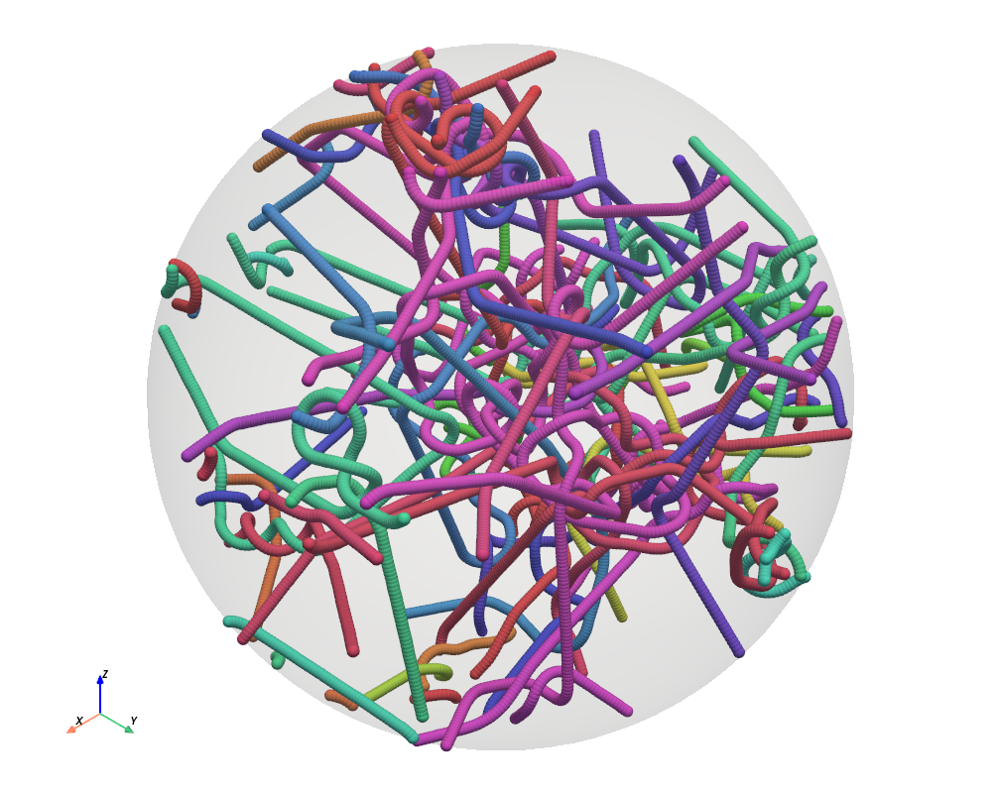
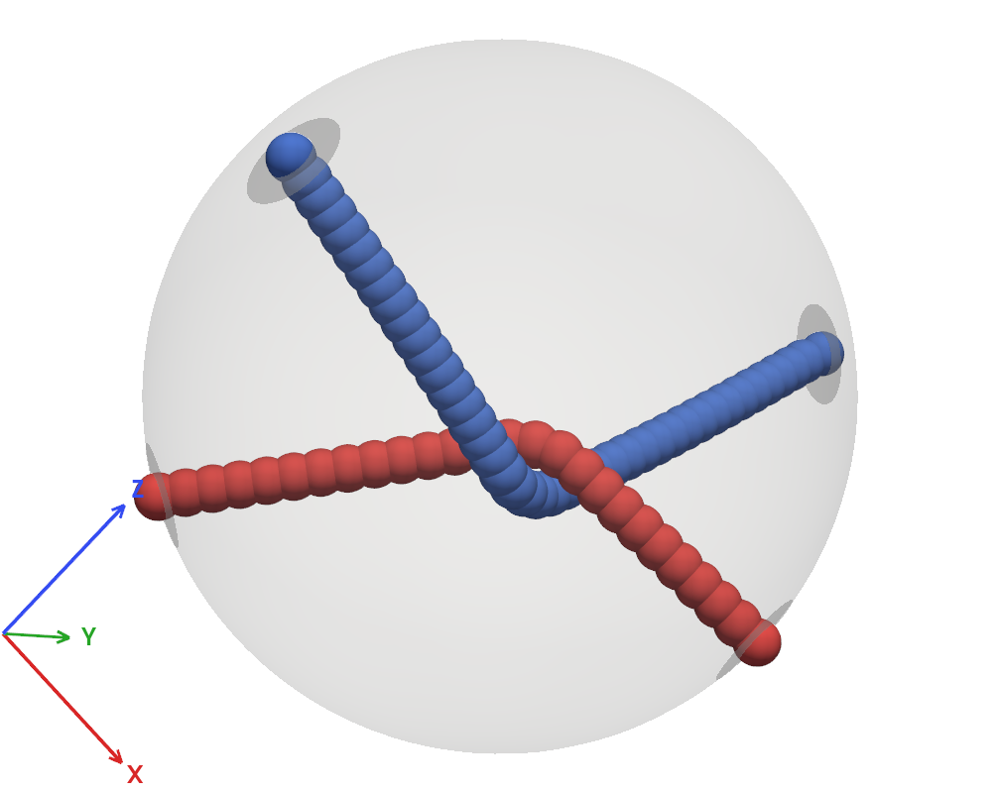
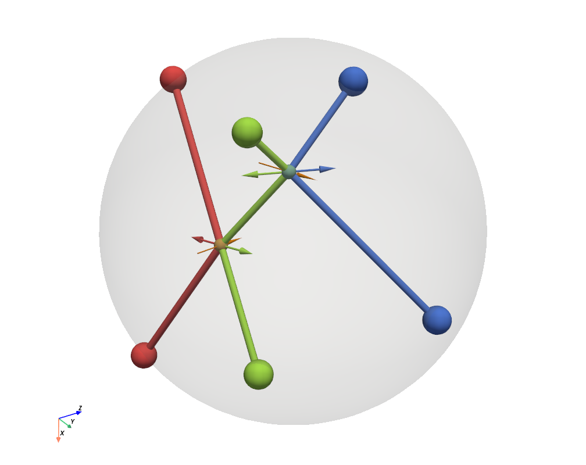

# EntanglementSimulator

Three scripts to experiment with Entanglements.

## Dependencies

```
pip install pyvista numpy
pip install imageio imageio-ffmpeg   (movies)
```

## Before you run

Note that to capture keys, the keyboard layout should be set in the code.
Default value is KEYBOARD_LAYOUT = "nordic", other options are us, uk, de.

## kgview.py



kgview.py visualizes KG dump files produces with LAMMPS, essentially it is a KG microscope. 

Initially beads inside a spherical volume centered on 0,0,0 is shown with a certain radius. You can do 3D rotations and zoom of the conformation. The size of the volume shown can be controlled by r/R, the size of the beads with w/W. Display of beads is toggled with b/B while bonds are always shown. The arrow keys move the center position thus shifting which beads are shown. Shift arrow-up/down in and out of the conformation. Use kgview.py --help to see all the options.

You can store views (rotation, center position) with shift+ 1-9, and restore a view with 1-9. This creates smooth transitions between the stored views. Use m/M to start/stop recording movies. p to save a png image. s to save a dump file of what is inside the volume.

** Note **: The script becomes very slow if you render all beads in the melt, or if you by accident start the PPA dynamics which is very experimental. Recording movies while manually rotating the view does not work very well.

## beadppa.py



Implementation of beadppa logic. Polymers are sequences of beads, the chain ends are placed on the surface of a spherical volume. The end beads can be moved, while the PPA contraction dynamics is continually running, thus you can see how an entanglement dynamically responds to its environment.

You can interactively grab and drag chain ends on the surface. Use shift and mouse-drag to the horizon of the sphere to move chain ends between the front and back surface of the sphere. The PPA dynamics minimize contour length by placing a bead at the average position of its two neighbors, while overlapping beads bead on different chains are shifted to avoid overlap. Some times this produces a jittering motion.

Use a add new chains to make arbitrary complicated entanglements. Grab the end of a bead and use left or right arrow to add or remove beads to the chain. You can also grab and press 'd' to delete a polymer. Some times chains will pass through each other, to avoid that add more beads along the contour. The beads are added between the end and the first internal bead. When you grow or shrink the volume (keys r/R), beads are inserted or removed, such that the entanglement is essentially unaffected. Several of the short-cut keys for kgview.py also works for beadppa.py. Run beadppa.py --help for complete information.

## lineppa.py  Vertex model



An attempt at implementing lineppa logic, the script is based on beadppa and many of the shortcuts still apply. Polymers are now straight lines. As in beadppa the ends can be moved on the spherical surface, and chains can be added and removed. The left and right arrow now insert additional contour length at the corresponding chain end.

When two lines get within a minimum distance (MIN_DISTANCE) of each other an entanglement vertex is created. The idea is to match the point when two beads touch in a beadppa. A thin dotted line illustrates the two points on the lines spatially closest to each other just before the vertex is created. When an entanglement is created, the vector between the two closest points on the line segments are stored in the vertex.

Each line segment is modelled as a spring with an entropic spring constant k/L, where k is a system constant, and L is the contour length of that segment. Entanglements moves spatially according to the net force generated by the four entangled strands. Contour length can slip across entanglements, while the total contour length of a polymer is preserved.

The width of a line segment illustrates its tension, when you decrease the contour length of a line segment, you increase its tension thus transiently pulling the entanglement towards the end. After a while the contour length has equilibrated along the chain. A chain with low total contour length is "stiff" and thus impacts the position of its entanglements more than a chain with a large total contour length.

Currently, the colored vectors at vertices illustrate the net force produced by the strands. The orange vector is the vector
of closest approach of what would be the beads in a beadppa.

I am currently working on how to update this vector to model entanglement destruction. Subtle...

** todo **: No support for cross-links or handling collisions between entanglements.

## cylinderppa.py  Cylinder model

** todo **: Not implemented at all.

I have not yet looked into this. The vertex model is complicated because you can create composite vertices of entanglement and cross-link vertices, because lines have zero width, and implementing each of these (up to some level of complexity) is nasty. On the other hand the graph structure of the resulting mesh is very natural and coarse-grained description of the physics. 

In the cylinder model we take the diameter of beads serious, and reflect this in the diameter of the lines. Thus entanglement vertices are never created, but kinks are created along the cylinders where they need to have a kink due to another cylinder. In this case, cross-link and entanglement coupling is simple, since they are fat objects that can never overlap, and each kink moves with the net force acting on it but with the constraint that no point on two line segments gets within MIN_DISTANCE from each other. This requires modelling repulsive line-line interactions and introducing and removing kinks accordingly. 


